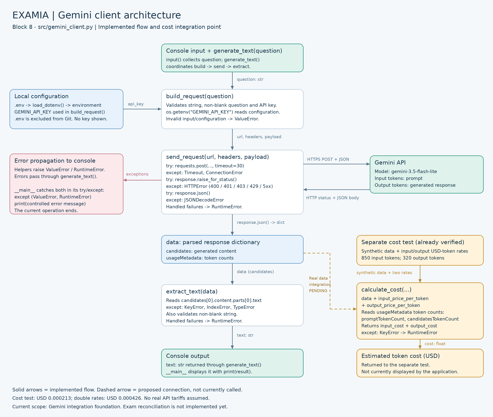

# Decisión de arquitectura: elección del modelo de IA

Fecha: 2026-11-21
Estado: aceptada para el prototipo; sujeta a reevaluación.

## Modelo elegido

Se elige `gemini-3.1-flash-lite`, mediante la API de Gemini.

El modelo apoyará la explicación de hallazgos y la elaboración de
resúmenes de conciliación de Examia para revisión humana.

Las validaciones, las reglas de negocio y los cálculos corresponden
a Python. El modelo no autoriza cobros ni pagos.

## Diagrama de arquitectura

El módulo `src/gemini_client.py` separa la preparación de la petición,
el envío y la extracción del texto.

La credencial se obtiene de la variable `GEMINI_API_KEY`, cargada desde
`.env`, y se utiliza en el encabezado `x-goog-api-key`.

`calculate_cost` permite estimar el costo a partir de `usageMetadata`.
Actualmente se prueba por separado: `generate_text` devuelve únicamente
el texto y no llama a esta función.

## Comparación de candidatos

### Precios

Fecha de consulta: 2026-11-21.

Tarifas estándar publicadas para entrada y salida de texto en el nivel
de pago, expresadas en USD por 1000 tokens. No representan cargos
observados durante las pruebas realizadas con la cuota gratuita.

| Criterio                                    |                                                                        gemini-3.5-flash-lite |                                                                             gemini-3.1-flash-lite |
| ------------------------------------------- | -------------------------------------------------------------------------------------------: | ------------------------------------------------------------------------------------------------: |
| Entrada por 1000 tokens                     |                                                                                  0,00030 USD |                                                                                       0,00025 USD |
| Salida por 1000 tokens                      |                                                                                  0,00250 USD |                                                                                       0,00150 USD |
| Latencia promedio observada                 |                                                                                1,74 segundos |                                                                                     1,40 segundos |
| Respuestas válidas en la prueba de latencia |                                                                                          4/4 |                                                                                               4/4 |
| Calidad para el caso                        | Resuelve los dos casos adicionales; introduce una regla no confirmada en el resumen inicial. | Resuelve los dos casos adicionales; introduce una inferencia no confirmada en el resumen inicial. |

Fuente:
[Precios oficiales de Gemini](https://ai.google.dev/gemini-api/docs/pricing)

La tarifa de salida incluye tokens de razonamiento.
La función actual `calculate_cost` solo considera `promptTokenCount`
y `candidatesTokenCount`; por tanto, no representa necesariamente
el costo facturable completo.

### Método de evaluación

Se envió la misma pregunta de resumen cuatro veces a cada modelo,
desde el mismo entorno local.

Se midió con `time.perf_counter()` el tiempo de ejecución de
`send_request`, incluido el procesamiento de la respuesta JSON.
No se incluyó el tiempo de preparación de la petición ni las pausas
entre solicitudes.

Tiempos observados:

- Gemini 3.5 Flash-Lite: 1,68; 1,95; 1,57; 1,76 segundos.
- Gemini 3.1 Flash-Lite: 1,70; 1,70; 1,11; 1,09 segundos.

También se evaluaron dos preguntas adicionales, una vez por modelo.
Los tres casos utilizados fueron ficticios:

1. Resumir exámenes firmados, pendientes y rechazados.
2. Explicar un examen ingresado y firmado en meses diferentes,
   sin una regla de imputación confirmada.
3. Explicar registros con el mismo identificador en distintos períodos,
   sin confirmar cobros o pagos anteriores.

Los scripts reproducibles son `src/compare_models.py`
y `src/evaluate_models.py`.

### Hallazgos de calidad

Ambos modelos evitaron asignar un mes cuando faltaba la regla y
solicitaron revisar antecedentes financieros ante registros repetidos.

Sin embargo, en la primera prueba:

- Gemini 3.5 Flash-Lite afirmó que los rechazados estaban
  "excluidos temporalmente", sin una regla que lo respaldara.
- Gemini 3.1 Flash-Lite agrupó pendientes y rechazados como registros
  sin firma, aunque no se había informado la firma de los rechazados.

Además, describir un cambio de estado entre períodos como duplicidad
o inconsistencia requiere cautela: puede tratarse de una actualización
normal del mismo examen.

## Justificación

Se prioriza que el modelo respete las reglas confirmadas y señale
la información pendiente.

En esta muestra, los dos candidatos resolvieron los casos adicionales
y ambos presentaron limitaciones en el resumen inicial. No se observó
una mejora de calidad suficiente en Gemini 3.5 Flash-Lite que justificara
preferirlo por sobre Gemini 3.1 Flash-Lite.

Gemini 3.1 Flash-Lite presentó menor latencia promedio y menores
tarifas publicadas de entrada y salida. Además, se confirmó su acceso
mediante peticiones exitosas con la clave del proyecto.

La elección es provisional: cuatro mediciones por modelo y tres casos
de calidad no permiten garantizar el comportamiento en otros escenarios.

## Alternativa descartada y por qué

Se descarta `gemini-3.5-flash-lite` para esta etapa del prototipo.

En las pruebas realizadas tuvo mayor latencia promedio y sus tarifas
publicadas son superiores, sin demostrar una ventaja de calidad
consistente para los casos evaluados.

Se podrá reconsiderar si nuevas pruebas muestran una mejora relevante
en fidelidad a los datos, claridad o cumplimiento de instrucciones.
